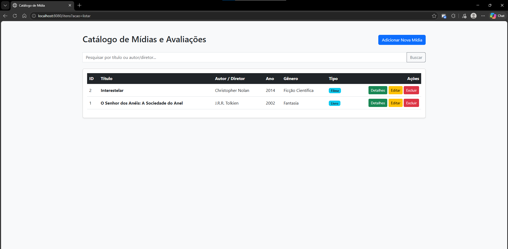
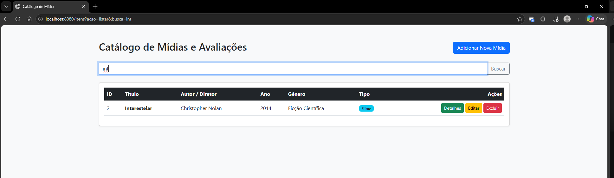
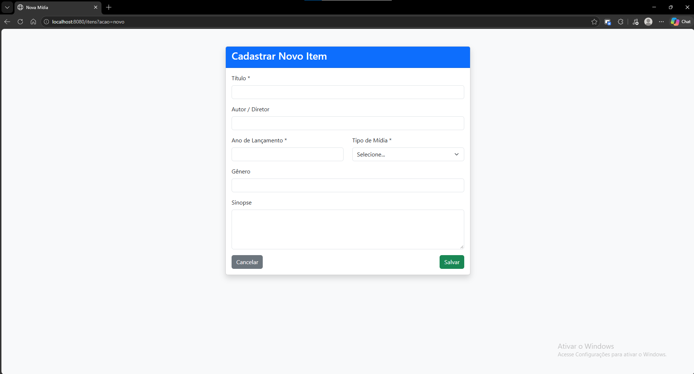
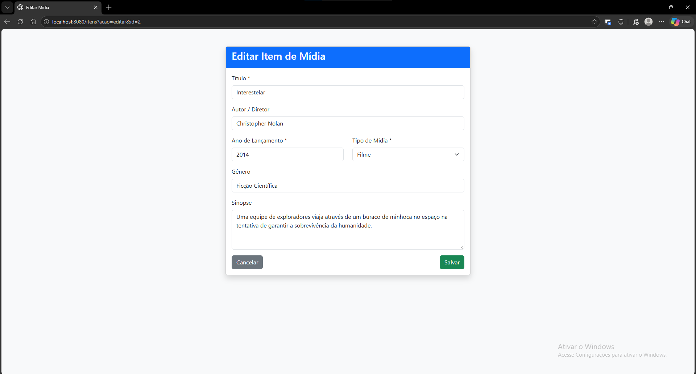
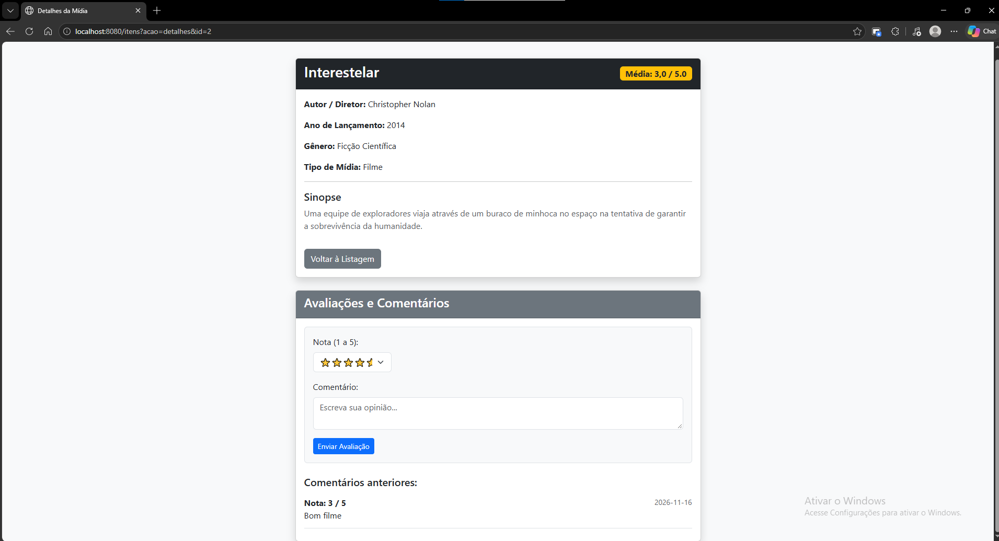

# 📚🎬 Catálogo de Mídias e Avaliações

Aplicação Web desenvolvida em **Java** utilizando a arquitetura **MVC (Model-View-Controller)**, **Servlets**, **JSP/JSTL** e **JDBC** com **MySQL**. O sistema permite catalogar, consultar, editar, excluir e avaliar diferentes tipos de mídia (livros, filmes, séries, jogos e álbuns).

Projeto desenvolvido como parte da disciplina **Projeto Integrador Transdisciplinar (PIT I) em Ciência da Computação** (Cruzeiro do Sul Virtual).

---

## 🚀 Funcionalidades

* **CRUD Completo de Mídias:** Cadastro, listagem, visualização de detalhes, edição e exclusão de itens.
* **Busca Dinâmica:** Pesquisa rápida por título ou autor/diretor utilizando consultas parametrizadas (`LIKE`).
* **Sistema de Avaliações:** Adição de notas (de 1 a 5 estrelas) e comentários em cada obra, com cálculo automático da média geral de avaliações.
* **Segurança e Validação:**
    * Prevenção contra **SQL Injection** através do uso estrito de `PreparedStatement`.
    * Prevenção contra **XSS (Cross-Site Scripting)** utilizando a tag `<c:out>` da JSTL nas views.
    * Validação centralizada de regras de negócio e campos obrigatórios (`ValidadorUtil`).

---

## 🛠️ Tecnologias Utilizadas

* **Linguagem:** Java (JDK 21 / 26)
* **Gerenciador de Dependências:** Apache Maven
* **Servidor de Aplicação:** Apache Tomcat 10.1 (Jakarta EE)
* **Camada de Apresentação:** JSP (JavaServer Pages), JSTL 3.0, HTML5 e Bootstrap 5
* **Persistência de Dados:** JDBC (Java Database Connectivity)
* **Banco de Dados:** MySQL 8+

---

## 🏗️ Arquitetura e Modelagem do Sistema

O projeto segue rigorosamente o padrão arquitetural **MVC em camadas**, isolando as responsabilidades entre interface, controle, regras de negócio e acesso a dados:

```text
catalogo-midia/
├── doc/
│   └── imagens/        # Diagramas (DER, Classes) e screenshots do sistema
├── src/main/java/br/com/catalogo/
│   ├── controller/     # Servlets (ItemMidiaServlet, AvaliacaoServlet)
│   ├── dao/            # Interfaces e implementações JDBC (ItemMidiaDAO, AvaliacaoDAO)
│   ├── model/          # Entidades de domínio (ItemMidia, Avaliacao)
│   ├── service/        # Regras de negócio e validações (ItemMidiaService)
│   └── util/           # Conexão com o banco e validadores (FabricaDeConexoes, ValidadorUtil)
├── src/main/webapp/
│   ├── WEB-INF/views/  # Telas JSP protegidas (lista.jsp, formulario.jsp, detalhes.jsp)
│   └── index.jsp       # Redirecionamento inicial para a Servlet principal
└── pom.xml             # Configuração do Maven e dependências
```

### Diagrama Entidade-Relacionamento (DER)


### Diagrama de Classes (UML)


---

## 🖼️ Demonstração das Telas

### 1. Listagem de Mídias
Exibição geral dos itens cadastrados no banco de dados com ações rápidas de gerenciamento.


### 2. Pesquisa por Título ou Autor/Diretor
Filtro dinâmico que consulta o banco de dados de forma segura contra SQL Injection.


### 3. Cadastro de Nova Mídia
Formulário com validação de campos obrigatórios e tipos de dados.


### 4. Edição de Mídia
Reaproveitamento dinâmico do formulário para atualização de registros existentes.


### 5. Detalhes e Avaliações
Visualização completa da sinopse, média geral calculada e histórico de comentários.


---

## ⚙️ Como Configurar e Executar o Projeto

### Pré-requisitos
* **JDK 21** ou superior instalado.
* **Apache Maven** configurado.
* **Apache Tomcat 10.1** (compatível com `jakarta.servlet`).
* **MySQL Server** em execução.

### Passo 1: Configurar o Banco de Dados
Execute o script SQL abaixo no seu cliente MySQL (Workbench, DBeaver ou terminal) para criar o schema e as tabelas:

```sql
CREATE DATABASE IF NOT EXISTS catalogo_midia
  CHARACTER SET utf8mb4
  COLLATE utf8mb4_unicode_ci;

USE catalogo_midia;

CREATE TABLE item_midia (
    id              INT PRIMARY KEY AUTO_INCREMENT,
    titulo          VARCHAR(255) NOT NULL,
    autor_diretor   VARCHAR(255),
    ano_lancamento  INT,
    genero          VARCHAR(100),
    sinopse         TEXT,
    tipo_midia      VARCHAR(50) NOT NULL
);

CREATE TABLE avaliacao (
    id              INT PRIMARY KEY AUTO_INCREMENT,
    item_midia_id   INT NOT NULL,
    nota            INT NOT NULL,
    comentario      TEXT,
    data_avaliacao  DATE NOT NULL,
    CONSTRAINT fk_avaliacao_item
        FOREIGN KEY (item_midia_id) REFERENCES item_midia(id)
        ON DELETE CASCADE,
    CONSTRAINT chk_nota CHECK (nota BETWEEN 1 AND 5)
);
```

### Passo 2: Ajustar Credenciais de Conexão
Abra o arquivo `src/main/java/br/com/catalogo/util/FabricaDeConexoes.java` e verifique se o usuário e a senha correspondem à configuração do seu MySQL local:

```java
private static final String URL = "jdbc:mysql://localhost:3306/catalogo_midia?useTimezone=true&serverTimezone=UTC&useSSL=false&allowPublicKeyRetrieval=true";
private static final String USUARIO = "root";
private static final String SENHA = "root"; // Altere se necessário
```

### Passo 3: Compilar e Rodar no Servidor
1. Clone ou baixe este repositório e abra-o em sua IDE (ex: IntelliJ IDEA).
2. Atualize as dependências do Maven (`mvn clean install`).
3. Configure o **Apache Tomcat 10.1** apontando para o artefato `catalogo-midia:war exploded`.
4. Inicie o servidor e acesse no navegador:
   ```text
   http://localhost:8080/catalogo-midia/
   ```

---

## 👨‍💻 Autor

Desenvolvido por **Gabriel Araujo Ferreira** — Projeto Integrador Transdisciplinar (PIT I).